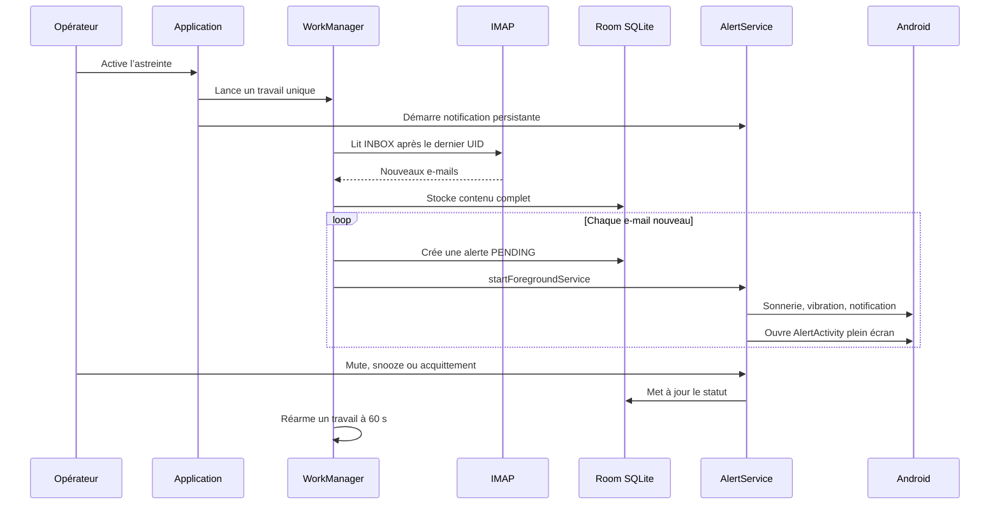

# Audit d’Asteintus — 29 septembre 2026

## Périmètre et niveau de confiance

Audit statique du dépôt fourni : application Android Kotlin/Compose, sans exécution sur appareil ni connexion à une boîte IMAP. Aucun test intrusif ou accès à un environnement tiers n’a été lancé. Les risques ci-dessous sont donc **confirmés par lecture de code** ou **probables à valider en recette**, pas des vulnérabilités exploitées en conditions réelles.

> L’archive ne contient ni `gradlew`, ni le JAR du wrapper Gradle. Les tests et la compilation reproductible n’ont donc pas pu être exécutés depuis le dépôt seul.

## Verdict

Le produit exprime clairement le bon problème : réveiller une personne d’astreinte à partir d’une boîte IMAP, avec acquittement et report. L’architecture de base (UI → cas d’usage → repositories → Room/IMAP) est compréhensible et plutôt proportionnée.

En revanche, il n’est pas prêt pour une promesse « haute priorité / résilient » : **tout nouvel e-mail devient une alerte**, le stockage du contenu des e-mails est **en clair**, et le mécanisme de synchronisation à 60 secondes n’est pas garanti par Android. Les affirmations de sécurité et de fiabilité de la documentation vont au-delà de l’implémentation actuelle.

## Ce que propose réellement l’application

- Configuration d’une boîte IMAP par identifiant/mot de passe, SSL/TLS ou STARTTLS.
- Activation d’un mode astreinte, synchronisation au démarrage puis tentative de réarmement après 60 secondes.
- Sauvegarde locale des dix derniers e-mails lors de la première synchronisation, puis des UIDs plus récents.
- Création d’une alerte pour **chaque** e-mail nouvellement sauvegardé.
- Sonnerie, vibration, notification plein écran, affichage sur écran verrouillé.
- Mute, snooze (5/15/30 minutes), acquittement, historique et purge à 30 jours.
- Redémarrage de la surveillance après boot lorsque le mode est encore actif.

## Flux réel d’une alerte



## Points forts

| Domaine | Constats |
|---|---|
| Sécurité transport | IMAP en clair explicitement refusé ; STARTTLS imposé ou IMAPS avec vérification d’identité serveur (`ImapClient.kt:152-178`). |
| Secrets IMAP | Les identifiants sont déposés dans `EncryptedSharedPreferences` avec `MasterKey` (`EncryptedPreferences.kt:34-58`). |
| Surface Android | Activités et service critiques non exportés ; `allowBackup=false` et trafic clair désactivé (`AndroidManifest.xml:16-61`). |
| Anti-duplication | UID unique pour les e-mails et vérification avant insertion (`MailMessageEntity.kt:7-10`, `MailRepositoryImpl.kt:56-81`). |
| Limitation de conservation | Politique de purge appliquée pendant la synchronisation worker (`MailSyncWorker.kt:101-106`). |
| UX incident | Acquittement, snooze, file d’attente en mémoire et notification publique générique pour limiter l’exposition sur écran verrouillé. |

## Risques et faiblesses prioritaires

| Priorité | Constat et preuve | Impact | Décision minimale recommandée |
|---|---|---|---|
| **P0** | La base Room est explicitement non chiffrée : `isCipherActive = false` et `Room.databaseBuilder(...)` sans SQLCipher (`AppDatabase.kt:20-33`). `DatabaseKeyProvider` existe mais n’est jamais utilisé. | Corps complets d’e-mails, expéditeurs, sujets et historiques lisibles depuis la base sur terminal compromis/rooté ou extraction forensique. La documentation « SQLite chiffré » est fausse. | Soit intégrer réellement SQLCipher/Room chiffré et une migration, soit retirer cette promesse et minimiser fortement les données stockées. Pour une app d’astreinte, conserver seulement l’extrait nécessaire est souvent le choix le plus simple. |
| **P0** | Aucun filtrage de criticité, expéditeur, dossier ou règle métier : chaque mail créé est transmis à `triggerAlertForMail` (`MailSyncWorker.kt:56-68`; même logique au sync manuel `MainViewModel.kt:120-130`). | Faux positifs, tempête d’alertes, désensibilisation, réveils intempestifs. Le premier sync peut sonner les 10 derniers e-mails historiques (`ImapClient.kt:97-104`). | Introduire une règle d’éligibilité explicite avant persistance/alerte : liste d’expéditeurs autorisés + sujet/header/tag + dossier dédié. Au premier appairage, mémoriser le curseur IMAP sans déclencher d’alerte. |
| **P0** | WorkManager ne garantit ni une cadence de 60 secondes ni l’exécution en veille/Doze. Le code enchaîne des `OneTimeWorkRequest` différés (`MailSyncWorker.kt:129-143`). | La promesse « surveillance continue / 60 s » n’est pas tenable ; alertes retardées ou manquées selon l’OS, batterie, réseau, restrictions constructeur. | Assumer une architecture d’astreinte : push serveur (FCM) ou IMAP IDLE dans un service foreground, avec monitoring de fraîcheur. Ne pas présenter WorkManager comme un scheduler temps réel. |
| **P1** | Le receiver de boot est exporté sans permission et traite également l’action `QUICKBOOT` (`AndroidManifest.xml:63-71`; `OnCallReceiver.kt:12-28`). | Une autre application peut vraisemblablement envoyer un broadcast explicite et provoquer des tentatives de reprise/service : déni de batterie ou comportement non attendu. | Rendre le receiver non exporté si possible, ou vérifier une permission de signature / dépendre exclusivement du broadcast système adéquat. Tester l’envoi explicite depuis une app tierce. |
| **P1** | Le rendu HTML d’e-mail utilise un `WebView` sans filtrage de navigation ni blocage des ressources réseau (`MailDetailScreen.kt:293-300`). JavaScript est désactivé, ce qui est bien, mais images et liens restent du contenu distant non fiable. | Tracking (IP/UA via pixel), phishing dans la WebView, surface WebView inutile pour une app d’astreinte. | Afficher du texte par défaut. Si HTML indispensable : désactiver accès réseau/chargement d’images, neutraliser les liens ou les ouvrir après confirmation dans le navigateur. |
| **P1** | `fallbackToDestructiveMigration()` (`AppDatabase.kt:32`). | Une mise à jour de schéma peut effacer mails et audit trail sans avertissement : mauvais pour une application d’incident. | Écrire des migrations versionnées ; à défaut, bloquer/alerter plutôt qu’effacer silencieusement. |
| **P1** | Le curseur IMAP repose uniquement sur l’UID. L’UIDVALIDITY du dossier n’est ni lu ni stocké ; l’UID est spécifique au dossier/à sa validité (`MailRepositoryImpl.kt:47-50`, `ImapClient.kt:93-105`). | Après recréation du dossier ou changement UIDVALIDITY : messages ignorés ou incohérences ; risque opérationnel silencieux. | Persister `(mailbox, UIDVALIDITY, lastUid)`. Si UIDVALIDITY change : positionner le curseur, appliquer une politique de rattrapage explicite, ne pas alerter l’historique. |
| **P1** | Le crash reporter enregistre stack trace et diagnostic dans des `SharedPreferences` non chiffrées (`CrashReporter.kt:45-62`). | Les traces peuvent contenir du contexte sensible ; conservation illimitée et contraire à la logique de minimisation annoncée. | Utiliser le stockage chiffré, supprimer les messages sensibles, fixer une durée de rétention et ne jamais passer la stack trace entière en Intent. |
| **P2** | Config réseau de pinning placeholder pour `mail.entreprise.example` seulement, avec empreinte de démonstration (`network_security_config.xml:8-15`). De plus le client IMAP Jakarta Mail ouvre ses propres sockets : cette config Android ne constitue pas une stratégie de pinning générique démontrée. | Fausse assurance de pinning ; expiration 2027 sans gouvernance de rotation. | Retirer le pin fictif. Pour des hôtes d’entreprise connus, implémenter et tester le pinning dans la pile IMAP, avec deux pins réels et procédure de rotation. |
| **P2** | Les erreurs de sync sont loguées puis le worker retourne `Result.success()` (`MailSyncWorker.kt:70-98`). | Android ne peut pas appliquer un backoff utile ; l’utilisateur n’a pas de signal fiable que l’astreinte est aveugle. | Distinguer erreur réseau temporaire (`Result.retry()`), erreur d’authentification (état bloquant visible), et succès. Ajouter une alerte « dernière synchro trop ancienne ». |
| **P2** | La file d’alertes est uniquement en mémoire du service (`AlertService.kt:56-58`, `196-214`). | Mort du processus : ordre de file et état de sonnerie perdus ; la reprise dépend d’un prochain worker. | Dériver la prochaine alerte de la base persistée à chaque reprise ; ne pas considérer l’ArrayDeque comme source de vérité. |
| **P2** | Notification : les canaux Android sont configurables par l’utilisateur/OS et `setBypassDnd(true)` n’est pas une garantie. L’app demande l’exemption batterie mais ne prouve pas l’obtention de toutes les autorisations. | Risque de promesse excessive : « outrepasser DND / réveil garanti » n’est pas portable Android. | Écran de readiness avant activation : notifications, policy access/DND, batterie, plein écran, dernier sync, test de sonnerie. Afficher clairement les limitations constructeur/OS. |

## Incohérences documentation ↔ code

1. **« Client d’alerte haute priorité »** : aucune notion de priorité n’est calculée ; tous les e-mails sont critiques.
2. **« SQLite chiffré »** : faux à ce stade ; la base est Room SQLite standard.
3. **« Synchronisation toutes les 60 secondes robuste »** : WorkManager ne fournit pas cette garantie.
4. **« File d’attente résiliente »** : seulement en mémoire de processus.
5. **SMTP configuré** : aucun usage SMTP trouvé. C’est un champ et une donnée sensible inutiles aujourd’hui.
6. **Firebase/Gemini/Retrofit/OkHttp** : dépendances présentes ou déclarées sans flux produit correspondant visible. Elles augmentent la surface de supply chain et brouillent le périmètre.

## Éléments structurants manquants

### 1. Contrat d’alerte

Il manque le cœur du produit : une politique versionnée qui dit *quel message doit réveiller qui*.

Minimum :

```kotlin
fun isAlertEligible(mail: RemoteMailMessage, policy: AlertPolicy): Boolean =
    mail.senderAddress in policy.allowedSenders &&
    policy.subjectPattern.containsMatchIn(mail.subject)
```

À terme, préférer un destinataire/dossier dédié, des headers signés ou un webhook/push provenant de l’outil d’alerting. Le parsing libre d’e-mails ne doit pas être la source d’autorité d’un incident P1.

### 2. Modèle de fiabilité observable

Il manque : `lastSuccessfulSyncAt`, cause de dernière erreur, état de permissions, âge maximum admissible, batterie/réseau et un mécanisme d’escalade hors téléphone.

Critère produit : « l’utilisateur peut savoir en moins de 5 secondes si la chaîne est apte à alerter ».

### 3. Identité et modèle d’accès

Le compte IMAP partagé et son mot de passe permanent sont un point faible organisationnel : révocation difficile, pas d’attribution individuelle, accès plus large que nécessaire. OAuth/app-password à périmètre minimal ou relais d’alertes dédié est préférable.

### 4. Observabilité et conformité

Il manque une exportation/effacement maîtrisés, une politique de suppression vérifiable, une notice de traitement, et un audit trail qui capture l’action et son contexte sans stocker inutilement le contenu du mail.

### 5. Livraison logicielle

Le dépôt n’est pas buildable seul (wrapper Gradle absent), pas de CI visible, pas de scan de dépendances/secrets, pas de signature/release vérifiable ni de procédure de rollback.

## Couverture de test actuelle

Les tests couvrent essentiellement des exemples, le formatage de durée, et l’appel de deux use cases. Ils ne couvrent pas le risque réel.

Tests prioritaires :

1. Premier appairage : zéro alerte pour l’historique.
2. Éligibilité : mail non conforme → aucune alerte ; mail conforme → une seule alerte.
3. UIDVALIDITY modifiée et déduplication concurrente.
4. Redémarrage du process avec alertes `PENDING`/`SNOOZED`.
5. Réseau indisponible, timeout, auth invalide : backoff + état visible.
6. Réception d’un HTML avec image distante/lien : aucune requête involontaire.
7. Migration Room : aucune perte de l’historique et des alertes.
8. Tests instrumentés sur plusieurs versions Android pour permissions, foreground service, full-screen intent et Doze.

## Plan de remise à niveau minimal et ordonné

1. **Stopper les faux positifs** : politique d’éligibilité et premier sync silencieux.
2. **Protéger les données** : supprimer SMTP non utilisé ; choisir entre chiffrement réel de DB ou persistance minimale ; chiffrer/supprimer les crash logs sensibles.
3. **Ne plus promettre du temps réel impossible** : readiness UI + statut de fraîcheur ; choisir IDLE/push si SLA < 15 min.
4. **Fiabiliser l’état** : UIDVALIDITY, migrations Room, reprise persistée de la file, erreurs avec retry/backoff.
5. **Réduire l’exposition Android/WebView** : receiver protégé, HTML durci ou supprimé.
6. **Industrialiser** : restaurer Gradle wrapper, CI `lint + unit + instrumentation`, SBOM/SCA et secret scan.

## Questions de cadrage à trancher avant tout développement

1. Quel est le SLA réel : notification sous 1 minute, 5 minutes ou 15 minutes ?
2. Les alertes viennent-elles d’un expéditeur/domaine/dossier strictement contrôlé ?
3. Peut-on remplacer IMAP polling par webhook/push via un relais de confiance ?
4. Les appareils peuvent-ils être personnels/BYOD ou sont-ils gérés MDM ?
5. Le contenu complet des e-mails est-il réellement nécessaire localement, ou sujet/extrait/lien incident suffit-il ?
